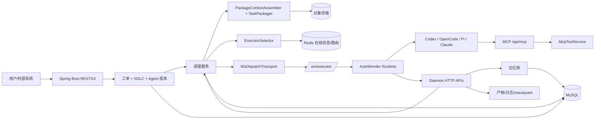
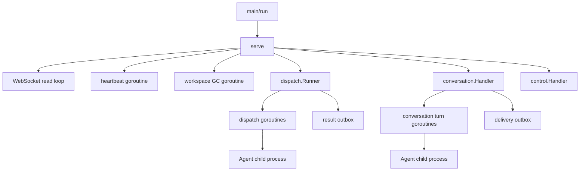
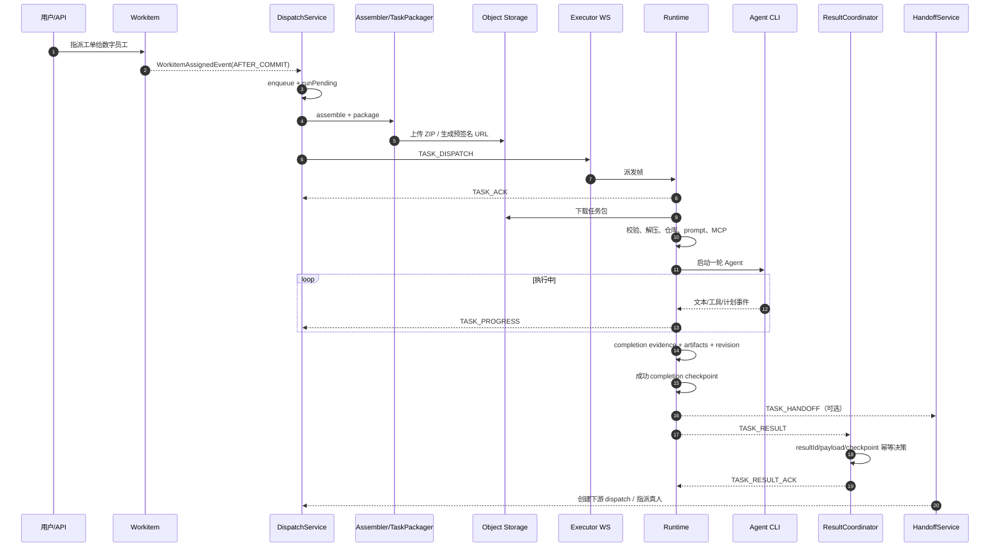
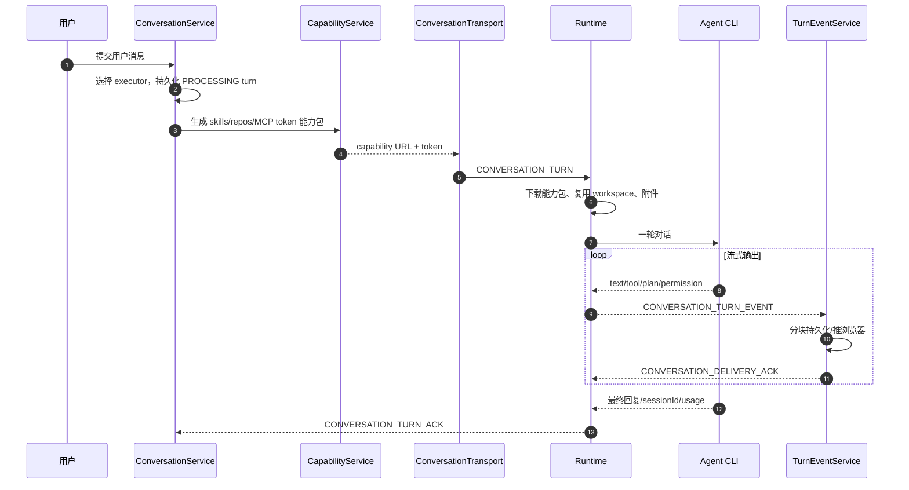

# AutoWonder Runtime 架构与模块说明

> 代码基线：2026-11-23 当前 WSL worktree 中的 Runtime 与服务端实现。
>
> 本文说明的是“代码现在怎么工作”，不是官方 Runtime 的规范承诺，也不是历史设计稿。
> 与本文冲突时，以当前 Go/Java 源码为准。更细的线协议字段见
> [`../../docs/scheduler-executor-protocol.md`](../../docs/scheduler-executor-protocol.md)。

## 1. 先建立正确的心智模型

AutoWonder 不是一个把所有 Agent 都托管在服务端的系统。它由两个运行时边界组成：

1. **服务端控制面**：保存工单、数字员工、Agent 版本、SDLC、执行器、调度状态、
   会话和记忆，决定“谁在什么上下文里执行哪一步”。
2. **Runtime 执行面**：以 executor 身份连接服务端，下载不可变任务包，在本地拉起
   Codex、OpenCode、Pi 或 Claude Code，回传进度、结果、产物和交接。

服务端不启动 Agent CLI；Runtime 不拥有工单、SDLC 或审批状态的最终权威。

### 1.1 三层协议

| 层 | 通信对象 | 协议 |
| --- | --- | --- |
| 调度层 | 服务端 ↔ Runtime | `/ws/executor` WebSocket JSON 帧 |
| Agent 层 | Runtime ↔ 本地 Agent CLI | Codex JSON-RPC、OpenCode CLI/ACP、Pi/Claude stream-json |
| 工具层 | Agent ↔ 服务端 | MCP over HTTP `/api/mcp` |

“调度成功”只表示 Runtime 接收到任务；“Agent 成功”只表示本地 CLI 完成了一轮执行；
“交付成功”还要经过结果协调、完成 checkpoint、产物回执和显式交接。

### 1.2 Runtime 同时支持两种执行模型

| 模型 | 入口帧 | 语义 | Runtime 主要模块 |
| --- | --- | --- | --- |
| 正式派发 | `TASK_DISPATCH` | 执行一个 SDLC 步骤，生成交付物并交接下一棒 | `internal/dispatch` |
| 交互会话 | `CONVERSATION_TURN` | 进行一轮对话，可调用平台 MCP、显示工具和人工问答卡 | `internal/conversation` |

两者都复用同一个 provider、仓库物化、MCP 配置和 WebSocket 连接，但状态机、
工作区、产物和可靠性保证不同。

### 1.3 当前代码里最重要的三个事实

1. **一个 dispatch 只负责一个步骤。** Runtime 不自己遍历完整 SDLC。
2. **下一棒当前由显式 handoff 驱动。** Runtime 读取
   `handoff-proposal.json` 并发送 `TASK_HANDOFF`；服务端 `HandoffService` 根据目标
   是数字员工还是真人更新工单并创建下一轮 dispatch。
3. **`SdlcDriver` 目前只是兼容接缝。** 当前
   `SdlcDriver.onSuccess()` 和 `onFail()` 都返回 `DriveResult.stop()`。
   旧文档里“服务端按 SDLC 自动排下一棒”的描述与当前实现不完全一致。

## 2. 总体拓扑



核心原则：

- MySQL 保存业务和审计事实。
- Redis 保存在线状态、路由、容量和跨节点广播。
- 对象存储保存任务包、checkpoint、产物和 debug log。
- Runtime 本地文件系统保存工作区、任务包解压内容、不可靠传输的持久 outbox。
- Runtime 心跳上报的运行清单是“本执行器实际在跑什么”的运行态证据。

## 3. 状态归属

| 状态 | 权威来源 | 说明 |
| --- | --- | --- |
| 工单、当前 SDLC/步骤、assignee | MySQL | `workitem` / `sdlc` |
| Agent 身份、当前在线版本、技能、仓库权限 | MySQL | `agent` / `agent_version` 等 |
| SDLC 定义和工作流快照 | MySQL + 对象存储中的任务包 | 任务包冻结执行上下文 |
| Executor token 身份 | MySQL | `ExecutorDO.tokenRef` |
| Executor 在线、session、容量、路由 | Redis | 心跳续期，TTL 过期即不再路由 |
| dispatch 状态 | MySQL | `DispatchStatus` |
| dispatch 结果幂等记录 | MySQL | `dispatch_result_decision` / `DispatchResultStore` |
| completion checkpoint 与 result 绑定 | MySQL | `dispatch_recovery_checkpoint` |
| 任务包、checkpoint、artifact、debug log | 对象存储 | 通过预签名 URL/HTTP 上传接口访问 |
| dispatch 工作区、正在运行请求 | Runtime 内存 + 本地文件系统 | 通过 HEARTBEAT 暴露 |
| 会话轮次、事件、问答卡、答案投递 | MySQL | `AgentConversation*` |
| 会话可靠事件 outbox | Runtime 本地文件系统 | 服务端 ACK 后删除 |
| 平台记忆 | MySQL 文档记忆库 | `memory_store` / `memory_document` 等 |

## 4. 服务端模块

本节只覆盖与 Runtime 直接相关的服务端模块，不展开前端和普通 CRUD。

### 4.1 业务对象与执行器

| 包/类 | 职责 | 对 Runtime 的影响 |
| --- | --- | --- |
| `workitem.WorkitemService` | 工单创建、内容、状态、指派和交付控制 | 指派 Agent 后发布 `WorkitemAssignedEvent` |
| `clarification.ClarificationService` | 持久化工单需求澄清文档 | 被打进任务包 `clarification.md`，不等同于会话聊天记录 |
| `sdlc.*` | SDLC、步骤、检查项和工作流定义 | 被冻结进任务包 `sdlc.json` |
| `agent.AgentService` / `AgentVersionDO` | 数字员工身份、版本、技能和仓库绑定 | 决定任务包中的 identity、skills、repos |
| `executor.ExecutorController` | 创建/删除执行器、签发 token、生成启动配置 | Runtime 用 `executorId + token` 接入 |
| `executor.ExecutorService` | 持久化执行器、查询详情、记录连接信息 | 连接时服务端校验执行器归属 |
| `executor.ExecutorWsAuthenticator` | 校验 WS 查询参数中的 executor token | 失败直接关闭连接 |
| `executor.ExecutorSelector` | 从在线执行器中按容量、Provider 能力和偏好选择 | 决定 `TASK_DISPATCH.executorId` |

### 4.2 WebSocket 接入与在线状态

| 类 | 职责 |
| --- | --- |
| `websocket.ExecutorWsEndpoint` | `/ws/executor` 入口，处理鉴权、注册、收帧和断连 |
| `websocket.SessionRegistry` | 保存本节点 executorId → `ExecutorSession`；新连接替换旧连接 |
| `websocket.PresenceManager` | 用 Redis 保存在线状态、session、capacity、feature、running inventory，TTL 90 秒 |
| `websocket.NodeMailboxListener` | 接收 Redis 广播，把跨节点消息投递给本节点持有的 WS 会话 |
| `websocket.InboundFrameRouter` | Runtime 上行帧的总路由器 |
| `websocket.WsDispatchTransport` | 构造并发送 `TASK_DISPATCH` |
| `websocket.WsConversationTransport` | 构造并发送会话、取消、问答回复和命令探针帧 |
| `websocket.WsDispatchControlTransport` | 发送 pause/stop 控制 |
| `websocket.WsGuidanceTransport` | 发送 steering、guidance 和评论交互 |

关键行为：

- 同一 executor 只能有一个当前 session；新连接会导致旧连接被替换。
- `HEARTBEAT` 不是普通保活，它还刷新：
  - `exec:online:{executorId}`
  - `exec:route:{executorId}`
  - `exec:session:{executorId}`
  - `exec:capacity:{executorId}`
  - `exec:protocol-features:{executorId}`
  - running/owned dispatch 和 conversation turn inventory
- 心跳中的数组不能是 `null`。声明 `dispatch_inventory_v1` 时，非法清单会触发
  `EXECUTOR_PROTOCOL_INCOMPATIBLE` 并关闭会话。
- 服务端根据心跳清单执行恢复，而不是仅相信数据库中的旧状态。

### 4.3 正式派发模块

| 类 | 职责 |
| --- | --- |
| `DispatchAssignmentListener` | 监听工单指派事务，在提交后创建 dispatch 并调度 |
| `DispatchService` | 调度核心：入队、选执行器、打包、准入、发送、ACK、进度、结果、重试和终止 |
| `DispatchAdmissionService` | 发送前在事务和行锁下再次确认管理状态与步骤身份 |
| `ExecutionAvailabilityService` | 校验 Agent 是否可用、SDLC 是否启用 |
| `ExecutorSelector` | 选择可用容量、具备所需协议能力的执行器 |
| `PackageContextAssembler` | 读取并冻结工单、澄清、评论、身份、SDLC、技能、仓库、记忆、roster |
| `TaskPackager` | 把上下文序列化为 ZIP，生成哈希、签名、上传对象存储、生成预签名 URL |
| `DispatchResultCoordinator` | 对 `TASK_RESULT` 做幂等决策和持久化 ACK |
| `DispatchResultStore` | 保存 resultId、payload hash 和最终 decision，支持重放 |
| `DispatchRecoveryService` | 失联执行、pause、stop、结果等待和 inventory 恢复 |
| `DispatchRuntimeReconciler` | 根据心跳 inventory 识别失联执行和执行器替换 |
| `DispatchPauseService` | pause/continue 状态和 checkpoint 回执 |
| `HandoffService` | 根据 `TASK_HANDOFF` 把执行转给数字员工或真人 |
| `SdlcDriver` | `DriveResult` 兼容接口；当前成功和失败都返回 STOP |

### 4.4 `DispatchService.runPending` 的实际顺序

`runPending` 不是简单的“发一个包”：

1. 获取 `dispatch:lock:{dispatchId}`。
2. 校验 Agent、在线版本、SDLC 和管理状态。
3. 获取 Agent 容量锁。
4. 选择执行器；连续恢复可能需要同一执行器。
5. 冻结模型选择。
6. `PackageContextAssembler` 组装上下文。
7. `TaskPackager` 生成 ZIP、上传对象存储、生成预签名下载 URL。
8. `PACKAGING → DISPATCHED`。
9. 通过本节点 WS 或 Redis 广播发送 `TASK_DISPATCH`。
10. 后续由 `TASK_ACK`、`TASK_PROGRESS`、`TASK_RESULT` 推进状态。

打包失败不会盲目重发：会区分永久输入错误、存储配置错误和可重试错误。

### 4.5 结果协调

`DispatchResultCoordinator` 是 V2 结果的幂等边界：

- V2 必须有 UUID `resultId` 和 `resultProtocolVersion=2`。
- 同一 resultId 的重复投递必须返回同一 decision。
- 相同 resultId、不同 payload 返回 `RESULT_ID_CONFLICT`。
- 成功结果必须带完成 checkpoint，且 `resultId + checkpointSeq + sha256` 与持久回执匹配。
- ACK 的 disposition 是 `ACCEPTED`、`REJECTED` 或 `RETRYABLE`。
- Runtime 只有收到可接受的 ACK 后，才删除本地 result outbox。

### 4.6 handoff 与下一棒

Runtime 成功后读取：

```text
artifacts/output/handoff-proposal.json
```

并发送：

```json
{
  "type": "TASK_HANDOFF",
  "dispatchId": 100,
  "workitemId": 200,
  "to": "reviewer",
  "toType": "AGENT",
  "nextRole": "reviewer",
  "reason": "implementation complete"
}
```

服务端行为：

- `toType=AGENT` 且目标可解析：切换工单 SDLC/步骤和 assignee，创建下游 dispatch。
- 目标不可用：按策略回退真人。
- `toType=HUMAN`：更新 assignee，停止自动执行。
- 同一 source dispatch 的重复 handoff 会复用已创建的下游 dispatch。
- 自动 handoff 有循环上限，防止数字员工之间无限转派。

当前代码中，合法的显式 handoff 与普通 `SdlcDriver` 下一棒互斥，避免一个终态派发产生
两个权威后继。

### 4.7 会话模块

| 类 | 职责 |
| --- | --- |
| `AgentConversationService` | 会话和轮次持久化、取消、恢复、ACK |
| `PlatformConversationService` | 平台管家会话的创建、分页、归档、分享和发消息 |
| `WorkitemClarificationConversationService` | 工单澄清会话和附件绑定 |
| `ConversationExecutorRouter` | 选择支持该 Agent 和协议能力的会话执行器 |
| `ConversationCapabilityService` | 组装技能、仓库、MCP token、环境变量并生成能力包 |
| `WsConversationTransport` | 下发 `CONVERSATION_TURN` 等帧 |
| `ConversationTurnEventService` | 持久化事件、重组分块、更新 `cliSessionRef`、推浏览器 |
| `ConversationElicitationService` | ACP 问答卡状态机和过期处理 |
| `ConversationAnswerDeliveryService` | 人工答案可靠投递和 ACK |
| `ConversationCommandsService` | 斜杠命令探针和快照 |

会话和正式派发的差别：

- 没有 SDLC step。
- 没有 completion checkpoint 和 formal artifact 契约。
- 会话 workspace 按 `conversationId` 长期复用。
- 事件既可流式展示，也可持久化用于刷新和恢复。
- 会话 MCP token 绑定 conversation/turn/attempt/executor/agent version。

### 4.8 MCP、记忆、产物和日志

| 包/类 | 职责 |
| --- | --- |
| `mcp.McpController` | `/api/mcp` JSON-RPC、SSE、`tools/list`、`tools/call` |
| `mcp.McpAccessTokenService` | 通用 MCP token 的签发、解析和权限边界 |
| `mcp.DispatchMcpTokenService` | dispatch 级 JWT，绑定 workspace、user、dispatch、agent |
| `mcp.ConversationMcpTokenService` | conversation 级 JWT，平台会话通常封顶只读 |
| `mcp.McpToolService` | 所有 `autowonder.*` 工具的权限、领域和参数处理 |
| `memory.MemoryService` | 旧结构化记忆 |
| `memory.store.MemoryStoreApplicationService` | 新版文档记忆库 |
| `memory.store.DaemonMemoryController` | dispatch 级 snapshot/changes/mutations/recalls/maintenance API |
| `artifact.DaemonArtifactController` | multipart 产物上传、类型识别和持久化 |
| `dispatch.DaemonCheckpointController` | checkpoint 上传、下载 URL 刷新、回执 |
| `debuglog.DebugLogUploadController` | debug log 直传签发 |

### 4.9 控制与恢复模块

| 类 | 职责 |
| --- | --- |
| `GuidanceService` | 评论触发的非终止式指导，投递给目标活跃执行 |
| `DispatchGuidanceService` | 针对单个 dispatch 的终止式 steering |
| `DispatchRecoveryService` | pause、stop、失联、暂停回执和恢复 |
| `ExecutorRestartService` | `EXECUTOR_RESTART` 控制 |
| `ExecutorUpdateService` | `EXECUTOR_UPGRADE` 控制 |
| `WorkspaceCleanupTransport` | 通知 Runtime 清理已失效工作区 |

执行器能力不是“版本号推断”，而是 `HEARTBEAT.protocolFeatures` 显式协商。

定时任务复用同一套 Runtime 协议。服务端通过持久化的 `ExecutionSourceType`
区分普通 `WORKITEM` 和 `SCHEDULED_TASK_RUN`，`TASK_DISPATCH` 本身不增加来源字段；
服务端处理回调时以持久化 dispatch 的来源为准，不信任客户端自行填写的 workitemId。

## 5. Runtime 进程模型



进程特性：

- 单个 Go 进程。
- 一个 WebSocket 读循环。
- 一个心跳协程。
- 一个工作区 GC 协程。
- dispatch 和 conversation 各自有并发信号量。
- 每个 dispatch/turn 都启动独立 Agent 子进程。
- WebSocket 断开时当前 session context 取消，在途 Agent 终止；恢复由服务端重投或 outbox
  重放完成。

## 6. Runtime 模块字典

### 6.1 入口与配置

#### `cmd/autowonder-runtime`

职责：

- 解析命令和参数。
- 构建 provider。
- 检测 OpenCode 是否支持 ACP。
- 建立 WS 连接。
- 启动 dispatch、conversation、heartbeat、workspace GC 和 control handler。
- 发布 Runtime feature 清单。
- 处理更新回滚和 hook 子命令。

关键文件：`cmd/autowonder-runtime/main.go`

#### `internal/config`

职责：

- 从环境变量或命令行加载 executor、provider、并发、workspace、memory、GC、更新配置。
- 校验 URL、ID、token、provider、memory mode、并发范围和 reasoning 参数。
- 生成带 query token 的 `/ws/executor` endpoint。

关键文件：`internal/config/config.go`

### 6.2 连接与协议

#### `internal/ws`

职责：

- 包装 gorilla/websocket。
- 15 秒握手和写超时。
- 16 MiB 读取上限。
- 单 reader、并发安全 writer。

#### `internal/protocol`

职责：

- 定义服务端和 Runtime 的 JSON 帧。
- 与 Java `websocket/frame/*.java` 字段对齐。
- 覆盖 dispatch、ack、pause、checkpoint、memory、debug log、conversation、
  elicitation、heartbeat 和 control。

这一层只做数据结构，不含业务状态机。

### 6.3 正式派发

#### `internal/dispatch`

职责：

- 管理 owned/running dispatch。
- 用信号量限制 dispatch 并发。
- 接收 `TASK_DISPATCH`、pause、stop、steer 和 guidance。
- 运行单个 dispatch 的完整生命周期。
- 维护持久 result outbox。
- 上报 inventory。
- 处理 completion checkpoint、artifact、debug log、handoff 和终态结果。

关键文件：

- `internal/dispatch/runner.go`
- `internal/dispatch/result_outbox.go`

一次 `runCore` 的顺序：

1. 校验平台环境变量。
2. 下载并验签任务包。
3. 加载 hooks。
4. 物化仓库。
5. 安装 Git hooks。
6. 拉取平台 memory snapshot。
7. 恢复 checkpoint。
8. 启动 dispatch-scoped loopback API。
9. 构造 prompt。
10. 生成 MCP 配置。
11. 拉起 provider。
12. 归一化进度事件。
13. 写 `runtime-source-revision.json`。
14. 按 `completion_requested.evidenceRefs` 上传产物。
15. 发送 handoff。
16. 成功时上传 completion checkpoint。
17. 写 result outbox 并发送 `TASK_RESULT`。

### 6.4 任务包与仓库

#### `internal/capsule`

职责：

- 下载任务 ZIP。
- 校验 MD5、SHA-256。
- 可选校验 Ed25519 envelope。
- 防路径穿越和 ZIP symlink。
- 创建 dispatch 目录结构。

目录：

```text
dispatch-{id}/
├── task-package.zip
├── package/
├── workspace/repos/
├── artifacts/output/
├── state/
└── runtime-debug.log
```

#### `internal/repos`

职责：

- 解析 `repos.json`。
- 区分 eager 和 lazy。
- clone/fetch。
- 解析 pinned commit、ref、delivery branch 和 fallback。
- 创建交付分支。
- 从 checkpoint 恢复 commit。
- 写 source revision。

安全边界：

- 仓库名和路径只能是单路径段。
- URL 不能以 `-` 开头。
- Git 错误中的 user-info 会脱敏。
- 不把 token 写入仓库。

#### `internal/prompt`

职责：

- 把任务包转换成 Agent prompt。
- 固定顺序：身份 → 当前步骤 → 工单 → 澄清/评论 → 技能 → 仓库 → 记忆 →
  roster → workspace/completion/handoff 契约。
- 明确输出目录、失败标记和 completion event 格式。

Prompt 是“执行契约的最后拼装层”，不改变服务端冻结的上下文。

### 6.5 MCP、记忆与 loopback API

#### `internal/mcpconfig`

职责：

- 把 provider-neutral `mcp.config.json` 转成各 CLI 能理解的配置。
- 内置 `autowonder` MCP 不能被任务包同名覆盖。
- 解析 `headerSecretRefs` / `envSecretRefs`。
- 文件权限固定 `0600`。

#### `internal/memory`

职责：

- 下载 dispatch memory snapshot。
- 渲染为 `package/memory/platform-snapshot.md`。
- 代理 changes、mutations、recalls。
- 管理 maintenance lease。

#### `internal/localapi`

职责：

- 在 `127.0.0.1:随机端口` 启动 dispatch 专用 HTTP 服务。
- `/request-input`：Agent 主动请求人工审批/输入。
- `/dispatches/{id}/step-events`：转发 completion 和 step events。
- `/memory/*`：转发 memory API。
- 只接受 loopback 请求。

#### `internal/requests`

职责：

- 调 `/api/daemon/dispatches/{id}/requests` 创建问题。
- 轮询人工答案。
- context cancel 时取消问题。
- 计算 approval fingerprint。

### 6.6 Provider 适配

`internal/provider/provider.go` 定义统一接口：

```go
type Provider interface {
    Name() string
    Run(context.Context, Request, func(Event)) (Result, error)
}
```

`Request` 只描述一轮 Agent 执行；provider 不接触 WebSocket、任务包或 artifact。

| Provider | 驱动方式 | 会话 | 主要特点 |
| --- | --- | --- | --- |
| Codex | `codex app-server --listen stdio://` + JSON-RPC | `thread/resume` | 原生审批、elicitation、steering、token usage |
| OpenCode CLI | `opencode run --format json` | `--session` | dispatch 当前主要使用此模式 |
| OpenCode ACP | `opencode acp` + JSON-RPC | `session/load` | 结构化 tool/plan、权限卡、usage，主要用于会话 |
| Pi | `pi -p --mode json` | session file | stdout 控制标记解析 |
| Claude | `claude -p --output-format stream-json` | `--resume` | 原生 tool hooks |

#### Steering

`internal/provider/steering.go` 为四个 provider 提供统一的主动中止/重启：

- Codex：原生 `turn/steer`。
- OpenCode：取消当前 turn，再用同一 session 提交 steering。
- Pi/Claude：取消后用各自 session 参数恢复。

### 6.7 交互会话

#### `internal/conversation`

职责：

- 管理 conversation turn 并发。
- 下载 conversation capability 包。
- 复用 `<workspaceRoot>/conversations/{id}/workspace`。
- 下载受控附件。
- 生成 conversation MCP 配置和 prompt。
- 归一化 text/thinking/tool/plan/error 事件。
- 管理 delivery outbox、answer receipt 和 elicitation。
- 发送 terminal `CONVERSATION_TURN_ACK`。

关键文件：

- `internal/conversation/handler.go`：并发、路由、outbox、cancel、delivery ACK。
- `internal/conversation/turn.go`：单轮执行和事件映射。
- `internal/conversation/attachments.go`：附件 allowlist 和安全下载。
- `internal/conversation/elicitation.go`：人工问题状态。
- `internal/conversation/outbox.go`：可靠事件持久化。
- `internal/conversation/answer_receipts.go`：人工答案幂等。

### 6.8 Hooks、checkpoint、产物和日志

#### `internal/hooks`

支持触发点：

- `beforeRepoPrepare`
- `beforeStep`
- `beforeAgentStart`
- `afterAgentExit`
- `beforeCommit`
- `beforePush`
- `cleanup`
- Claude `beforeTool` / `afterTool`

Git hooks 通过仓库级 `core.hooksPath` 安装，并链式调用仓库原 hooks。

#### `internal/checkpoint`

职责：

- 从已提交仓库 HEAD 生成 checkpoint。
- pause 时上传。
- 成功结果前上传 `COMPLETION` checkpoint。
- resume 时校验 SHA-256 并恢复 commit。

不包含未提交工作区文件。

#### `internal/upload`

职责：

- v2 协议按 `completion_requested.evidenceRefs` 只上传显式引用文件和
  `runtime-source-revision.json`。
- 旧协议可回退到整棵 artifacts 树。
- 拒绝绝对路径、`..`、目录和非普通文件。

#### `internal/debuglog`

职责：

- 记录 dispatch 生命周期、Agent 事件和原始 stdout/stderr。
- 按协商 maxBytes 截断。
- 脱敏 executor token、MCP token、MCP secret 和敏感环境变量。
- 优先申请对象存储直传；失败可按开关走 artifact relay。

### 6.9 控制、更新和清理

#### `internal/control`

职责：

- `EXECUTOR_RESTART`：`WHEN_IDLE` 或 `FORCE`。
- `EXECUTOR_UPGRADE`：检查更新、drain、执行 updater、上报 receipt。
- drain 时拒绝新 dispatch/turn。
- 用 `AUTOWONDER_RESTART_REQUEST_ID` 在新进程心跳中确认重启。

#### `internal/update`

职责：

- 获取签名 manifest。
- 选择平台 artifact。
- 校验 Ed25519、SHA-256、版本和时效。
- 候选二进制 `--version` 自检。
- 原子替换。
- 启动版本不匹配时回滚。

#### `internal/workspacegc`

职责：

- 清理终态 dispatch capsule 和长期不活跃 conversation workspace。
- 活跃 dispatch、活跃 conversation、pending result outbox 永不清理。
- 支持 TTL 和磁盘压力模式。
- 先移动到 `.gc-trash`，再删除。

## 7. 正式派发完整时序



注意：`TASK_HANDOFF` 表示“建议下一棒”，`TASK_RESULT` 表示“当前派发已经终态”。
两者共同完成一次正式交付步骤。

当前 Runtime 用两个独立帧发送它们，而不是把 handoff 嵌入 result。两者不是同一次
原子提交：handoff 帧丢失时，Runtime 的 result outbox 只会重放 `TASK_RESULT`，不会
重放已经发送失败的 `TASK_HANDOFF`。服务端 `DispatchResultCoordinator` 已能处理
result 内的 `handoff`，但当前 Runtime 的 `sendHandoff` 仍使用独立帧。这是阅读和修改
可靠性链路时必须注意的边界。

## 8. 会话轮次完整时序



会话与正式派发的可靠性边界：

- 事件 outbox 保存到本地，服务端 ACK 后删除。
- terminal ACK 也进入 outbox，断线重连不会重复执行已完成的 turn。
- `session/load` 回放的历史事件不会计入当前轮输出。
- 浏览器刷新依赖数据库中的 turn event，不依赖 Runtime 内存。

## 9. 可靠性设计

### 9.1 幂等

| 场景 | 幂等键 |
| --- | --- |
| dispatch 创建 | `idempotencyKey` |
| dispatch result | `resultId` + payload hash |
| completion checkpoint | resultId + checkpointSeq + sha256 |
| conversation event | conversationId + turnId + attempt + eventSeq + chunkIndex |
| answer delivery | answerId / requestId |
| guidance | guidanceId |

### 9.2 断线恢复

- Runtime 主循环按 `1s → 2s → … → 30s` 重连。
- dispatch result outbox 在重连和每 30 秒重放。
- conversation outbox 在重连和每 5 秒重放。
- 服务端通过 heartbeat inventory 判断 Runtime 是否仍拥有某次执行。
- 断线期间不能把 conversation turn 标记为用户取消；必须交给服务端恢复。

### 9.3 暂停与恢复

- `TASK_PAUSE(cancel=false)`：Runtime 取消当前 Agent，生成 checkpoint，发送
  `TASK_PAUSED`。
- `TASK_PAUSE(cancel=true)`：终止，不发暂停 checkpoint。
- 成功后 Runtime 发送工作流 checkpoint，服务端把它与 result 绑定。
- resume 时服务端下发 checkpoint URL、候选 checkpoint、provider session 信息。

### 9.4 执行器失效

- Provider 认证/额度等基础设施错误可上报 `failureCategory`。
- 服务端将同一 dispatch 返回 PENDING，换执行器，不消耗业务重试预算。
- 恢复连续依赖原 Provider session 时，可能要求同一 executor。
- 心跳 inventory 缺失时，服务端等待宽限期并使用 checkpoint/result 证据恢复。

## 10. 安全边界

| 边界 | 机制 |
| --- | --- |
| Executor 身份 | WS query 中的 executorId + token |
| 任务包 | MD5、SHA-256、可选 Ed25519、24h 时效 |
| 任务包解压 | 拒绝 `..`、绝对路径、symlink |
| 仓库 | 单段名称/路径；fetch/clone 使用宿主 Git 凭据 |
| MCP | JWT 绑定 workspace、user、dispatch/conversation、agent version |
| 附件 | 只接受 server origin、`*.aliyuncs.com` 或显式 allowlist |
| 产物 | 只允许普通文件和受控相对路径 |
| Debug log | token/secret/env 脱敏，大小限制 |
| 容器 | 独立 UID/HOME/CODEX_HOME，不挂载宿主 Agent 配置 |

需要特别区分：

- `allowCommit` / `allowPush` 当前主要是 prompt 和 workflow 约束。
- 真正的权限边界应通过 Git remote 权限、容器网络、SSH key/credential helper 或代理层实现。

## 11. 能力协商

Runtime 在 `runtimeFeatures()` 中声明能力，例如：

- `dispatch_inventory_v1`
- `AGENT_ENVIRONMENT_VARIABLES_V1`
- `TASK_MODEL_SELECTION_V1`
- `TASK_PACKAGE_SIGNATURE_V1`
- `TASK_PACKAGE_HOOKS_V1`
- `DEBUG_LOG_V1`
- `DISPATCH_REQUESTS_V1`
- `EXECUTOR_RESTART_V1`
- `EXECUTOR_UPDATE_V1`（仅在配置更新源后）
- `CONVERSATION_TURN_EVENT`
- `CONVERSATION_DELIVERY_ACK_V1`
- `CONVERSATION_ANSWER_DELIVERY_V1`
- `CONVERSATION_ACP_INTERACTION_V1`（仅 Codex 或支持 ACP 的 OpenCode）
- `ATTACHMENT_MANIFEST_V1`
- `terminal_steer_v1`

服务端在发帧前检查所需 capability：

- 有环境变量但没有 `AGENT_ENVIRONMENT_VARIABLES_V1` → 拒绝派发。
- 有模型选择但没有 `TASK_MODEL_SELECTION_V1` → 拒绝派发。
- 任务包要求 blocking tool hooks 但没有 `TASK_PACKAGE_TOOL_HOOKS_V1` → 拒绝。
- 会话需要可靠 ACK 但 Runtime 未声明 → 使用兼容行为。

## 12. 当前实现边界

### 12.1 正式派发

- 一个 dispatch 只执行一个步骤。
- 下一棒由显式 handoff 驱动。
- `SdlcDriver` 当前不计算下一节点。
- OpenCode 正式派发当前走 CLI JSON 模式；ACP 主要用于会话。
- v2 成功结果要求 completion checkpoint。
- 产物优先按 explicit evidence refs 上传。
- `TASK_HANDOFF` 当前是独立、非持久的发送路径，不在 result outbox 中；如果使用显式
  handoff 作为唯一下一棒来源，需要保证该帧的可靠投递或把交接并入 result。

### 12.2 Provider

- Codex：能力最完整，JSON-RPC、审批、steering 和 usage 已接入。
- OpenCode：CLI 与 ACP 两条路径并存；dispatch 和 conversation 的选择不同。
- Pi：CLI 和 session 恢复；没有原生审批卡。
- Claude：stream-json、session resume 和原生 tool hooks；没有原生 ACP 卡。

### 12.3 尚未完全等价的能力

- Codex/OpenCode/Pi 的 blocking tool hooks 尚未全部接入。
- Pi/Claude 原生审批桥接仍不完整。
- `ARTIFACT_OUTPUT_V1` 和 `ACTION_PLAN_V1` 仍未完整实现。
- lazy 会话仓库的细粒度生命周期仍有优化空间。
- 容器内 Codex 不能再嵌套 bubblewrap，因此当前用容器边界替代嵌套 sandbox。

## 13. 按问题定位代码

| 你想知道 | 先看 |
| --- | --- |
| Runtime 如何启动 | `runtime/cmd/autowonder-runtime/main.go` |
| WS 帧字段 | `runtime/internal/protocol/frames.go` |
| dispatch 生命周期 | `runtime/internal/dispatch/runner.go` |
| 任务包如何解压/验签 | `runtime/internal/capsule/capsule.go` |
| 仓库如何选择 | `runtime/internal/repos/repos.go` |
| Agent prompt 如何拼 | `runtime/internal/prompt/prompt.go` |
| MCP 如何生成 | `runtime/internal/mcpconfig/config.go` |
| Codex 如何驱动 | `runtime/internal/provider/codex.go` |
| OpenCode CLI/ACP | `runtime/internal/provider/opencode.go` / `opencode_acp.go` |
| 会话如何执行 | `runtime/internal/conversation/*.go` |
| 服务端如何选执行器 | `dispatch/ExecutorSelector.java` |
| 服务端如何打包 | `dispatch/PackageContextAssembler.java` / `taskpackage/TaskPackager.java` |
| 服务端如何收结果 | `websocket/InboundFrameRouter.java` / `dispatch/DispatchResultCoordinator.java` |
| 下一棒怎么走 | `dispatch/HandoffService.java` |
| 会话如何下发 | `websocket/WsConversationTransport.java` |
| 会话事件如何落库 | `conversation/ConversationTurnEventService.java` |
| MCP 如何鉴权和调用 | `mcp/McpController.java` / `mcp/McpAccessTokenService.java` / `mcp/McpToolService.java` |

## 14. 推荐阅读顺序

### 第一次阅读

1. 本文第 1、2、7、8 节。
2. `docs/scheduler-executor-protocol.md` 的帧目录和任务包格式。
3. `runtime/cmd/autowonder-runtime/main.go`。
4. `runtime/internal/dispatch/runner.go`。
5. `dispatch/DispatchService.runPending`。
6. `websocket/InboundFrameRouter` 与 `DispatchResultCoordinator`。
7. `dispatch/HandoffService`。

### 开发某个模块前

- 改调度：先读 `DispatchService`、`ExecutorSelector`、`DispatchResultCoordinator`、
  `DispatchRecoveryService`。
- 改任务包：同时看 `PackageContextAssembler`、`TaskPackager`、`capsule`、`repos`、`prompt`。
- 改会话：同时看 `WsConversationTransport`、`ConversationCapabilityService`、
  `ConversationTurnEventService` 与 `internal/conversation`。
- 改 provider：先确认 `provider.Request/Event/Result` 的边界，不要绕过统一事件模型。
- 改 MCP：同时看 token 类型、tool permission、`mcp.config.json` 和 provider 注入方式。
- 改可靠性：同时检查服务端 result/event 状态机、Runtime outbox 和 workspace GC。

## 15. 一句话总结

服务端负责“决定和记账”，Runtime 负责“准备、执行和回传”；任务包是冻结输入，
WebSocket 是调度状态通道，MCP 是 Agent 回写平台的工具通道，结果协调和显式
handoff 共同完成一次可恢复、可审计的软件交付步骤。
